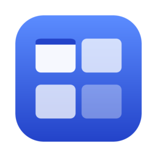
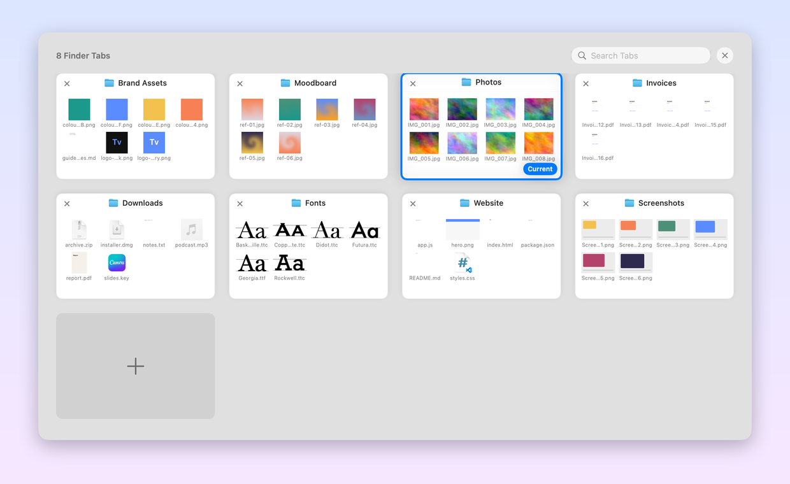
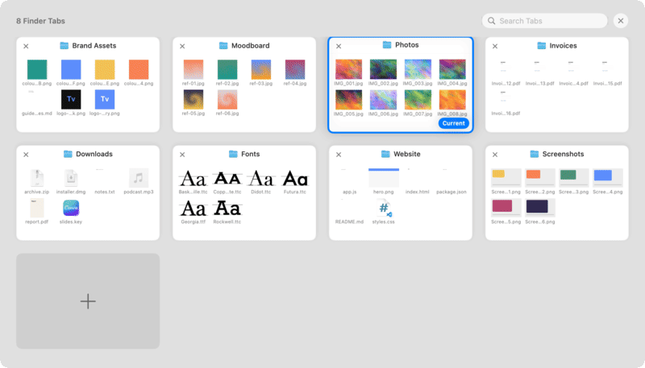
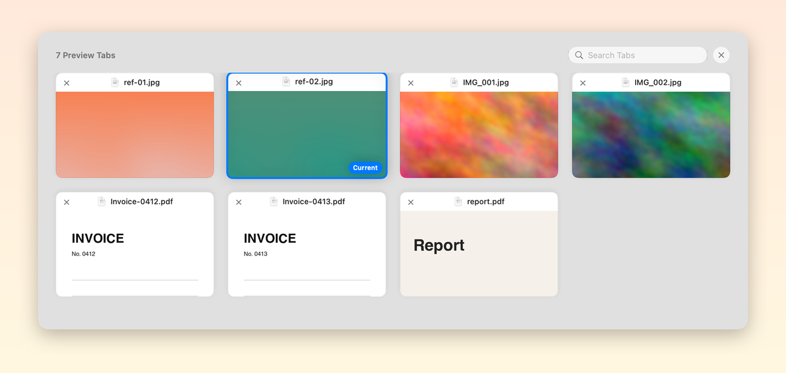
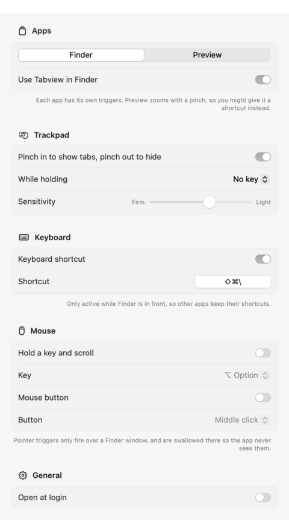

<div align="center">



# Tabview

**Safari's "Show All Tabs" grid, for Finder and Preview.**

Pinch in on your trackpad and every tab in the window spreads out as a card you can see, search and click.

[](#install)
[](Package.swift)
[](LICENSE)
[](https://github.com/nanadotam/tabview/releases/latest)

<picture>
  <source media="(prefers-color-scheme: dark)" srcset="docs/hero-dark.png">
  
</picture>

</div>

---

Safari has a lovely trick: pinch in and all your tabs zoom out into a grid. Finder has tabs too, and once you've got eight of them open
the tab bar turns into a row of truncated names: `Instagra…`, `Design Dir…`, `02 First In…`.

Tabview gives Finder and Preview the same grid. It's a tiny menu-bar app with no Dock icon and no window, and it shows up only when you call it.

<div align="center">
  
</div>

## Features

- **Pinch to see everything.** Pinch in over a Finder or Preview window and the grid appears. Pinch out and it's gone, just like Safari.
- **See what's inside each tab.** Finder cards show Quick Look thumbnails of the first few files in each folder, so you can tell
  two `Exports` folders apart at a glance. Preview cards show the document itself.
- **Search.** Start typing to filter tabs by name or full path.
- **Keyboard all the way.** Arrow keys to move, <kbd>Return</kbd> to switch, <kbd>⌘W</kbd> to close a tab, <kbd>Esc</kbd> to leave.
- **Your trigger, your way.** Trackpad pinch (optionally while holding a key), any keyboard shortcut you record, a modifier plus
  the scroll wheel, or a spare mouse button. Turn on whichever ones suit you, separately for Finder and Preview.
- **Fast.** The tab list comes straight from macOS Accessibility in a few milliseconds. Folder locations and thumbnails are fetched
  in the background and cached, so the grid paints instantly.
- **Stays out of the way.** It only reacts over Finder or Preview windows, and disappears the moment you switch to another app.

<div align="center">
  
  <br><sub>In Preview, each card is a snapshot of the document.</sub>
</div>

## Install

1. Download the **Tabview** zip from the [latest release](https://github.com/nanadotam/tabview/releases/latest) and unzip it.
2. Drag **Tabview.app** into **Applications**.
3. The app isn't notarised, so the first time, **right-click → Open**, then confirm. If macOS still refuses:
   ```sh
   xattr -dr com.apple.quarantine /Applications/Tabview.app
   ```
4. Grant the two permissions it asks for (see [Permissions](#permissions)).

It runs on Apple silicon and Intel Macs with macOS 14 Sonoma or later.

### Build from source

```sh
git clone https://github.com/nanadotam/tabview.git
cd tabview
./build.sh            # builds and installs to ~/Applications/Tabview.app
./build.sh --release  # universal build, zipped into build/
```

You only need the Xcode command-line tools. There's no `.xcodeproj`; it's a plain Swift package.

## Using it

| Do this | To |
| --- | --- |
| Pinch in over a Finder / Preview window | Show all tabs |
| Pinch out, <kbd>Esc</kbd>, click outside, or click the ✕ | Hide the grid |
| <kbd>⇧</kbd><kbd>⌘</kbd><kbd>\\</kbd> (customisable) | Toggle the grid |
| Click a card, or arrows + <kbd>Return</kbd> | Switch to that tab |
| ✕ on a card, or <kbd>⌘W</kbd> | Close that tab |
| Type anything | Search tabs by name or path |
| **+** card | New Finder tab |

### Choose your trigger

Everything lives in **menu bar icon → Settings…**

<div align="center">
<picture>
  <source media="(prefers-color-scheme: dark)" srcset="docs/settings-dark.png">
  
</picture>
</div>

| Trigger | Good for | Notes |
| --- | --- | --- |
| **Pinch** | Trackpad users | Optional modifier (e.g. hold <kbd>⇧</kbd> and pinch). Adjustable sensitivity. Never blocks Finder's own gestures. |
| **Keyboard shortcut** | Everyone | Record any combo. Only registered while Finder or Preview is in front, so Safari keeps its own <kbd>⇧⌘\\</kbd>. |
| **Modifier + scroll** | Mouse users | Hold e.g. <kbd>⌥</kbd> and flick the wheel. Swallowed over Finder so the window doesn't scroll. |
| **Mouse button** | Mice with extra buttons | Middle click, back or forward. |

Each app keeps its own set of triggers. Pick Finder or Preview at the top of Settings and set it up separately. Preview uses
pinch to zoom, so out of the box it listens only to the shortcut. You can turn its pinch back on with a key to hold, so zooming
out of a photo doesn't also open the grid.

### Automation

Tabview registers a `tabview://` URL scheme, so Raycast, Alfred, Shortcuts, BetterTouchTool or a shell script can drive it:

```sh
open -g tabview://toggle    # also: show, hide, settings
```

## How it works

Finder doesn't allow plug-ins that change its interface (Finder Sync extensions can only add badges, menu items and one toolbar
button), so Tabview is a separate app that draws over the window instead:

```
            pinch / shortcut / scroll / button
                          │
           ┌──────────────▼───────────────┐
           │  CGEventTap  ·  Carbon hotkey │   only fires when the pointer is over
           └──────────────┬───────────────┘   the front Finder/Preview window
                          │
   Accessibility API ─────┼──── AppleScript (background, cached)
   window → AXTabGroup    │     {name, URL of target} of every Finder window
   → tab buttons, order,  │     {name, path} of every document     (Preview)
     active tab, frame    │
                          ▼
            Non-activating NSPanel over the window
            SwiftUI grid + Quick Look thumbnails
                          │
               click → AXPress on the real tab
```

- **Tabs and switching** go through the Accessibility API. Finder's tab bar is an `AXTabGroup` of `AXRadioButton`s; reading it
  takes a few milliseconds and pressing one switches tabs exactly as a click would.
- **Folder and document locations** come from AppleScript. Finder exposes each *tab* as a scriptable "window", so one Apple Event
  returns every tab's folder in about 0.2 s. Asking tab by tab took over 20 s on a Google Drive–heavy setup, which is why the
  grid never waits for it: it's prefetched whenever Finder comes forward and merged in once it arrives.
- **The overlay** is a borderless, non-activating `NSPanel`, so Finder stays the active app the whole time. It closes itself as soon
  as another app comes forward or you change Spaces.

## Permissions

| Permission | Why |
| --- | --- |
| **Accessibility** | To read the tab bar, switch and close tabs, and see trackpad/mouse gestures. |
| **Automation → Finder / Preview** | To ask which folder or document each tab is showing, for the previews. |

Tabview has no network code and collects nothing. Everything it reads stays on your Mac.

## Known limitations

- Two tabs showing folders with the **same name** may swap previews. Switching and closing still hit the right tab, because
  those use the tab bar directly.
- Preview has no "new tab" command, so the **+** card only appears for Finder.
- The pinch is a trigger rather than a live zoom that follows your fingers. It fires once you pinch past a threshold.

## Roadmap

- [ ] Live, finger-tracking zoom animation
- [ ] More apps with native tabs (TextEdit, Pages, Terminal…)
- [ ] Drag cards to reorder tabs, or drop files onto a card to move them there
- [ ] Notarised builds and Homebrew cask

PRs welcome.

## Developing

```
Sources/Tabview/
├── main.swift            app delegate, menu bar, URL scheme
├── TabBridge.swift       Accessibility + AppleScript: reading and driving tab bars
├── Overlay.swift         the panel, show/hide lifecycle, keyboard handling
├── TabGridView.swift     SwiftUI grid, cards, Quick Look preview loading
├── Triggers.swift        hotkey + event tap (pinch, scroll, mouse button)
├── Preferences.swift     settings model
├── SettingsView.swift    settings window
└── ReadmeRenderer.swift  renders the screenshots in docs/ offscreen
```

`scripts/readme-art.sh` rebuilds every image in `docs/` from made-up demo folders, without touching your screen.

## License

[MIT](LICENSE) © Nana Kwaku Amoako
